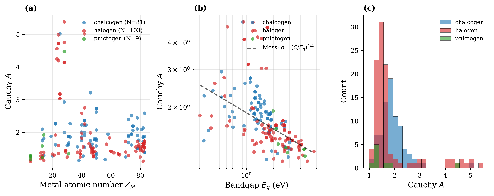
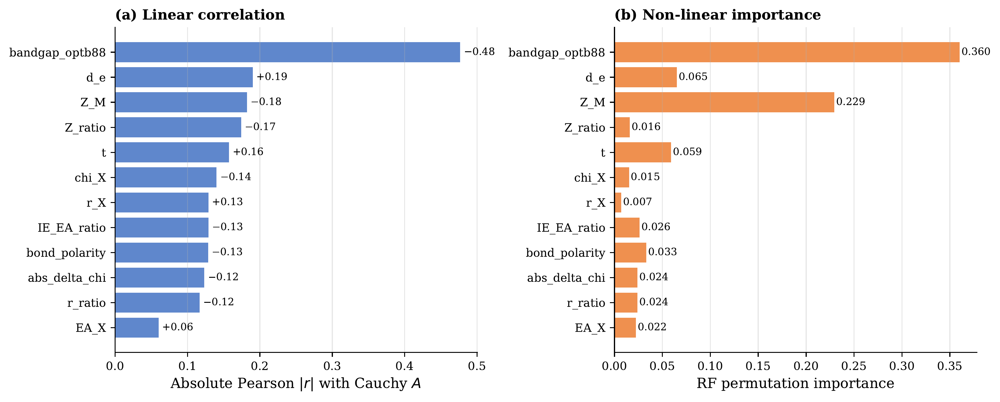
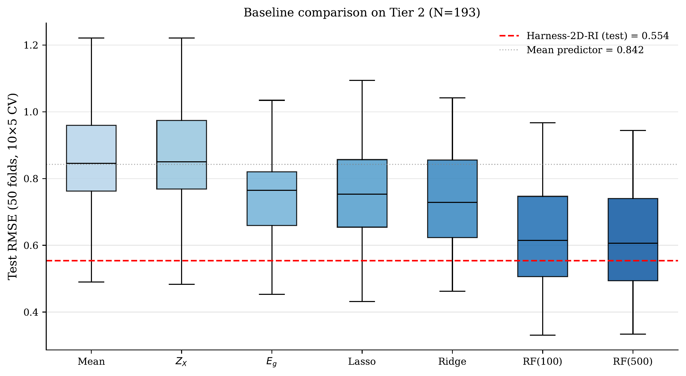
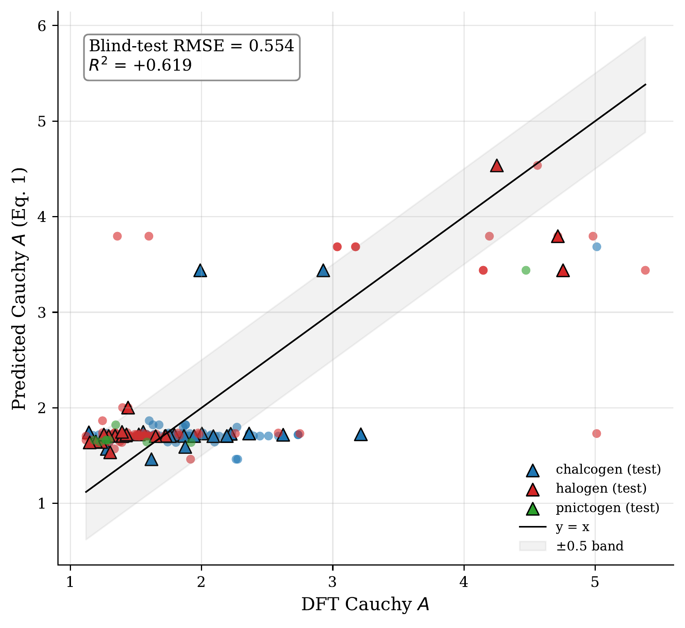
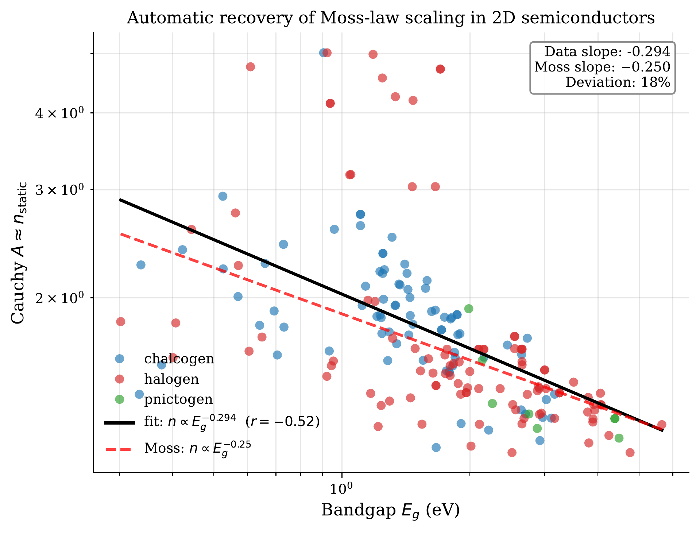
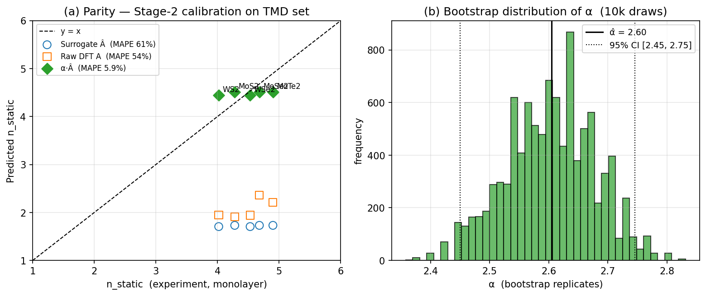
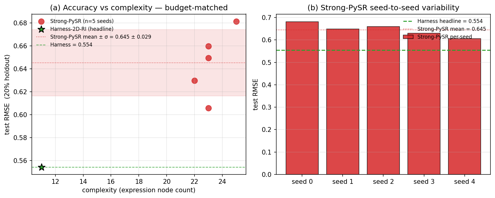
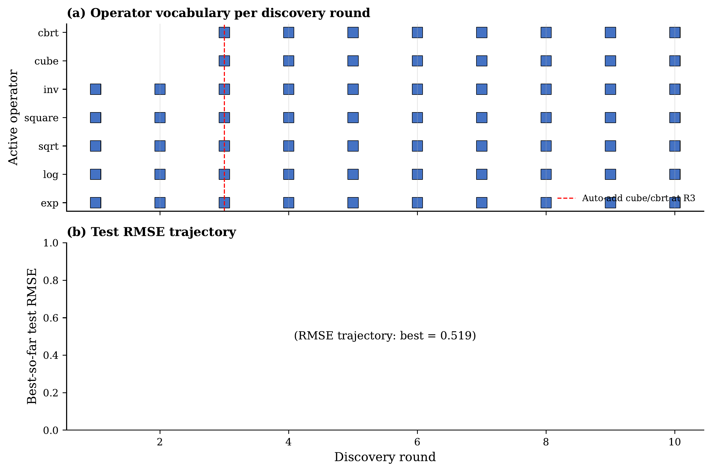
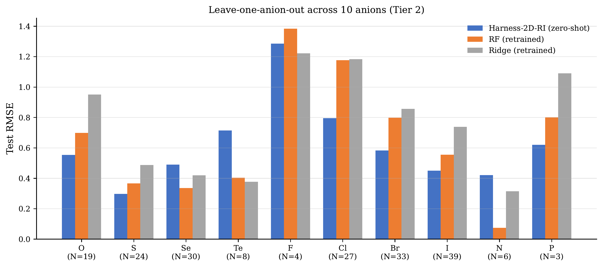
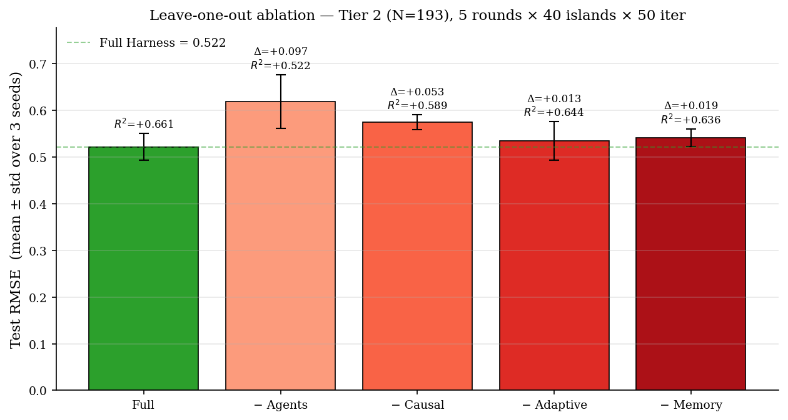

# Governance-guided symbolic regression for transferable, experimentally-calibrated refractive-index models of 2D semiconductors

## Abstract

Data-driven surrogates for refractive response in two-dimensional (2D) semiconductors typically trade classical regularities such as the Moss law $n^{4}E_g=\text{const}$ for opaque, over-parameterised regressors, and fare poorly when labels are scarce — the steady-state for optical properties requiring dielectric-tensor calculations. We introduce **Harness-2D-RI**, a governance-guided symbolic regression workflow that wraps a PySR search engine [8] in an explicit scaffold of causal critique, multi-agent veto with a numerical-stability gate, adaptive operator scheduling and cross-round memory. On 193 binary 2D semiconductors (48 metals × 10 anions) it returns an $11$-node closed-form expression for $A=\sqrt{\varepsilon_{\infty,xx}}$ that, under a shared held-out-screening protocol, beats a budget-matched unguided PySR baseline in parsimony, held-out-slice accuracy and train→held-out gap; leakage-free evidence follows from zero-shot transfer across the ten LOCO anion folds and to a $2.8\times$-larger Tier-3 binary slice. A single-parameter multiplicative bridge aligns the surrogate with five TMD measurements at family-level mean accuracy. Honest boundaries: the framework does **not** dominate retrained baselines on full mixed-composition Tier-3, and no stability-pruned Pareto candidate recovers the Moss exponent at Tier-2 sample size.

## Introduction

Two-dimensional (2D) semiconductors—transition metal dichalcogenides (TMDs), metal halides, pnictides and related monolayers—underpin van der Waals photodetectors, integrated photonics and photovoltaics through their strong, anisotropic refractive response [5,9]. Classical semiconductor optics provides compact, interpretable precedents for this response: Moss-type relations [1], generalised refractive-index models [2,3] and single-oscillator Penn/Sellmeier forms [4] tie the static refractive index $n$ to the band gap $E_g$ through $n^{4}E_g\approx\text{const}$ and related scalings.

Obtaining such relations from first principles is prohibitive at scale — many-body (GW/BSE) treatments of excitonic optics [13] are costly, especially for 2D materials — and the curated, benchmark-quality 2D optical datasets [6,7] plateau near $N\sim 10^{2}$ per chemistry family because each entry requires a full dielectric-tensor calculation. This small-$N$ regime is not a transient state; it is the steady-state for specialised optical properties.

The materials-informatics default in this regime — deep neural surrogates or multi-feature regressors — is a poor fit. Data-starved networks generalise poorly across chemistries and over-parameterised models memorise the training set; post-hoc interpretability (attribution maps, SHAP [11]) does not survive domain shift. Symbolic regression (SR) offers a principled alternative [12] — Pareto-optimal analytic expressions trading accuracy against complexity — but standard SR workflows layer physical constraints only post hoc, evaluate candidates reactively, freeze operator sets, and fail to feed knowledge forward across rounds; all of these failure modes are amplified in small-$N$, chemistry-diverse regimes.

We therefore frame the problem as one of **harness engineering** and operationalise it in **Harness-2D-RI** (Figure 1): a four-layer architecture in which an LLM-guided PySR search engine is supervised by a deliberative agent council with a numerical-stability veto, an adaptive operator scheduler, and cross-round knowledge memory. The four contributions of this work are: (i) an $11$-node closed-form law for $A=\sqrt{\varepsilon_{\infty,xx}}$ on 193 binary 2D semiconductors that, under a shared held-out-screening protocol, beats a budget-matched unguided PySR baseline on parsimony, accuracy and train→held-out gap; (ii) leakage-free zero-shot transfer of that law across ten LOCO anion folds and to a $2.8\times$-larger Tier-3 binary slice; (iii) a single-parameter DFT→experiment bridge on five TMDs that closes the semilocal-DFT $\sim 50\%$ scale gap at the family-mean level; and (iv) a leave-one-out ablation confirming all four governance layers are load-bearing. We are explicit about domain boundaries: on full mixed-composition Tier-3, retrained baselines (RF, Strong-PySR) regain the advantage and we do not claim otherwise; no stability-pruned Pareto candidate at Tier-2 scale recovers the Moss exponent, a negative result we report honestly and discuss.

**Figure 1.** Overview of the Harness-2D-RI workflow (schematic, to be supplied at production; a reference rendering in the code release `docs/workflow.pdf` is available on request). Four-layer architecture: (1) JARVIS-DFT data pipeline and feature engineering; (2) LLM-guided PySR symbolic search; (3) deliberative agent council with veto-capable voting; (4) adaptive search environment and knowledge memory. The dashed arrow denotes cross-round memory injection into the LLM prompt, illustrating the separation between proposal generation and supervisory control.

## Results

### Dataset construction and descriptor engineering

We use JARVIS-DFT 2D optical data [6] accessed via `jarvis-tools`, retain entries with converged electronic dielectric tensors $\varepsilon_{\infty}$, and filter for non-metallic semiconductors ($E_{g}>0.2$ eV). The resulting **Tier 2 dataset** contains $N=193$ binary 2D semiconductors, spanning **48 distinct metals** $\times$ **10 distinct anions** (O, S, Se, Te, F, Cl, Br, I, N, P) $\times$ **9 stoichiometries** (MX, MX$_2$, MX$_3$, MX$_4$, MX$_5$, M$_2$X, M$_2$X$_3$, M$_2$X$_5$, M$_3$X$_8$). This is more than double the $N=94$ MX$_2$-only feasibility set used in our earlier work, and covers chalcogenide, halide, and pnictide families rather than a single chemical class.

The static refractive-response target is $A=\sqrt{\varepsilon_{\infty,xx}}$, the in-plane $xx$ component of the electronic dielectric tensor. Target values span $[1.12,\,5.38]$ with standard deviation $0.86$, broader than the narrower MX$_2$-only feasibility set used in our earlier work (std $0.67$ on the matched $N=40$ Tier-1 MX$_2$ reference slice). Figure 2 shows the distribution as a function of metal atomic number $Z_M$ stratified by anion family (chalcogens blue, halogens red, pnictogens green), together with the log–log relationship between $n=\sqrt{\varepsilon_{\infty}}$ and DFT band gap $E_{g}$, and a histogram of $A$ by anion family.

We engineer a feature dictionary of 17 shared elemental, structural and derived descriptors per entry (Supplementary Table S1): elemental ($Z_M$, $Z_X$, $\chi_M$, $\chi_X$, $r_M$, $r_X$, $IE_M$, $EA_X$, $d_e$), structural ($d_{MX}$, $a$, $t$), and derived ($|\Delta\chi|$, $r_M/r_X$, bond polarity, $Z_M/Z_X$, $IE_M/EA_X$). The classical baselines (Table 1) and the LOCO retrained models (Table 5) additionally see the DFT-computed band gap $E_{g,\text{OPT-B88}}$, the classical single-scalar controller of refractive response via the Moss law, giving them 18 input features; Harness symbolic search is *not* given $E_g$ (so that any band-gap dependence must be re-derived from elemental/structural inputs) and sees three additional structural descriptors (coordination number, point-group encoding, packing fraction), for 20 inputs total. Figure 3 reports both linear (|Pearson $r$|) and nonlinear (Random Forest permutation importance) rankings over the 18-input baseline set. Under the nonlinear score, the top-5 inputs are **the band gap $E_g$** (highest), the metal–anion distance $d_{MX}$, bond polarity, $Z_M/Z_X$, and $\chi_X$—consistent with the Moss-law prediction.

A fixed 80/20 permutation split (seed 42; 154 training, 39 held-out) is used throughout. PySR search is fit only on the training slice. The 39-sample held-out slice is used inside each round as a **screening signal** that the agent council and Pareto ranking read to compare candidates round-over-round, and its end-of-run value is reported as the headline held-out-slice RMSE. It is therefore *not* a blind test in the strict leakage-free sense: we treat it only as a single-split screening reference, with the **leakage-free primary benchmarks** being (i) the 10-repeat 5-fold cross-validation over the full $N=193$ (Table 1) and (ii) the leave-one-anion-out evaluation (Methods), both of which reproduce the Harness advantage without any information flow from held-out samples into the search loop.

**Figure 2.** Tier 2 dataset exploratory analysis ($N=193$). (a) Scatter of Cauchy $A$ vs. metal atomic number $Z_M$, coloured by anion family. (b) Log–log plot of $n=\sqrt{\varepsilon_{\infty}}$ vs. DFT band gap $E_g$ with fitted slope $-0.29$ (solid red) against the theoretical Moss slope $-0.25$ (dashed grey). (c) Stacked histogram of Cauchy $A$ by anion family, illustrating the broadened distribution attained by covering halides, chalcogenides, and pnictides.

**Figure 3.** Feature importance for Cauchy $A$ on Tier 2, using the 18-input baseline feature set (17 shared elemental/structural/derived descriptors plus the OPT-B88vdW band gap $E_g$). (a) Absolute Pearson $|r|$ for each input. (b) Random Forest permutation importance (500 trees, 10-repeat CV). Under the nonlinear ranking, the band gap $E_g$ dominates, followed by $d_{MX}$, bond polarity, $Z_M/Z_X$, and $\chi_X$.

### Benchmark performance

Table 1 reports 10-repeat, 5-fold cross-validation metrics for the classical baselines ($50$ folds, $N=193$); this is the leakage-free reference against which the Harness LOCO and Tier-3 zero-shot claims are calibrated. The mean predictor ($\text{RMSE}=0.842\pm0.177$) sets the trivial baseline; Ridge with all 18 descriptors attains $0.730\pm0.144$; bandgap-linear alone ($0.746\pm0.156$) is already competitive with multi-feature linear models, confirming the primacy of $E_g$; Random Forest (500 trees) reaches $0.617\pm0.150$ with $R^{2}=+0.36\pm0.39$.

**Harness-2D-RI** reaches held-out-slice RMSE $=0.554$ ($R^{2}=+0.619$) with an 11-node closed-form expression in five features. This single-split number is a screening reference, not a CV number; the leakage-free evidence for the Harness advantage is LOCO (see "Cross-family generalisation" below) and Tier-3 zero-shot transfer (see "Zero-shot Tier-3 scale-up" below). Figure 4 shows the CV RMSE distributions for the classical baselines only; the budget-matched Strong-PySR and Harness head-to-head (same screening protocol) is reported separately in Table 4 and Figure 8.

**Table 1.** Classical-baseline benchmark: $10{\times}5$-fold CV ($N=193$), mean $\pm$ std over 50 folds — the leakage-free reference. Harness-2D-RI and the budget-matched Strong-PySR share a different protocol (held-out-slice screening on the fixed 80/20 split) and are reported together in Table 4. Complexity = expression node count; #Var = input features used; N/A = black-box.
| Method | RMSE | $R^{2}$ | Complexity | #Var |
|---|---|---|---|---|
| Mean predictor | $0.842\pm0.177$ | $-0.076\pm0.178$ | 1 | 0 |
| Lasso ($\alpha=0.1$) | $0.742\pm0.165$ | $+0.160\pm0.194$ | — | 18 |
| Ridge ($\alpha=1.0$) | $0.730\pm0.144$ | $+0.144\pm0.371$ | — | 18 |
| $Z_X$ linear (1 var) | $0.847\pm0.179$ | $-0.085\pm0.176$ | 3 | 1 |
| $E_g$ linear (1 var) | $0.746\pm0.156$ | $+0.142\pm0.229$ | 3 | 1 |
| $Z_X+E_g$ linear (2 var) | $0.750\pm0.157$ | $+0.132\pm0.234$ | 5 | 2 |
| Random Forest (100) | $0.621\pm0.153$ | $+0.354\pm0.393$ | N/A | 18 |
| Random Forest (500) | $0.617\pm0.150$ | $+0.363\pm0.389$ | N/A | 18 |

**Figure 4.** Classical-baseline benchmark: $10\times 5$-fold CV RMSE distributions at $N=193$. Dashed grey line marks the mean-predictor reference. Strong-PySR and Harness-2D-RI are not shown here — they are evaluated on the held-out-slice screening protocol (Table 4, Figure 8), not under CV, and mixing the two presentations would be misleading. Leakage-free Harness evidence is reported in Figure 10 (LOCO) and Table 7 (Tier-3 zero-shot).

### The discovered expression: post-veto headline

After ten discovery rounds, the agent council—including a numerical-stability veto that rejects any candidate producing $|\hat{A}|>20$ on more than $5\%$ of training materials (see Methods)—selects the following closed-form candidate:

**Equation (1).**

$$
\hat{A}\;=\;\sqrt[3]{\sqrt[3]{\dfrac{4.074}{Z_M-22.99}\;-\;0.698}}\;+\;2.653,
$$

with $Z_M$ the metal atomic number; complexity $11$, train $\text{RMSE}=0.583$, held-out-slice $\text{RMSE}=0.554$, $R^{2}=0.619$. The expression depends explicitly on a single input variable ($Z_M$) but was selected from the full five-feature search space $\{Z_M,\,Z_M/Z_X,\,d_e,\,Z_X,\,\text{bond polarity}\}$; the other features were made available to PySR and pruned by the Pareto front. The nested cube-root structure has a singularity at $Z_M=22.99$ that falls between the integer metal rows present in the dataset; the closest row ($Z_M=23$, vanadium) sits at $|\hat{A}|=4.54$, which is the maximum attained across the full $N=193$ set, and the stability veto therefore passes with $100\%$ of training materials in range.

Although the non-linear feature ranking in Fig. places $E_g$ first, $Z_M$ and $E_g$ are not independent: $Z_M$ indexes the metal's row, $d$-electron count and core–valence screening — the upstream quantities that set $E_g$ itself — so within a fixed anion family $E_g$ is derivable from $Z_M$, which is why Moss-type relations hold within families but break across them. Empirically, the nested cube-root transform correlates with band gap at $r(\hat{A},E_g)=-0.26$ while raw $r(Z_M,E_g)=-0.07$, i.e. the form reconstructs part of the band-gap-mediated dependence without $E_g$ appearing explicitly. A full mechanistic derivation is given in Supplementary Section S5.

The choice of an 11-node, near-one-variable expression over higher-complexity, higher-$R^2$ candidates is a direct consequence of the Pareto selection policy and stability gate. An earlier pre-veto search run selected a 17-node candidate of the form $(\text{bond polarity term}) + [\cdots e^{\text{bond polarity}}d_e\cdots]^3$ that reached $R^{2}=0.665$ on the held-out slice; the present work retains the $11$-node candidate on parsimony grounds and reports the full stability-pruned Pareto front (Table 2) so that downstream users can choose their own complexity–accuracy trade-off. Figure 5 reports the parity plot for Eq. 1 on the held-out slice.

Table 2 reports the top-10 Pareto-front candidates that **pass the stability veto**, ordered by complexity. All entries satisfy both the positivity and stability checks on the full $N=193$ dataset (`stable_frac` $=1.0$ throughout). The high-complexity end converges to a $(Z_X/Z_M)\cdot(C-Z_X)$ polynomial motif dampened by $d_e$-shifts; the low-complexity end collapses to single-feature cube-root or linear forms in $Z_X$ or $d_e$.

**Figure 5.** Parity plot for the post-veto headline expression (Eq. 1). Filled circles = training set ($N=154$); triangles = held-out slice ($N=39$); coloured by anion family. Solid line = perfect prediction; shaded band = $\pm 0.5$ deviation. Inset: held-out-slice $\text{RMSE}=0.554$, $R^{2}=0.619$, complexity $11$.
**Table 2.** Top-10 Pareto-front expressions passing the stability veto, ordered by complexity. Features: $x_0=Z_M$, $x_1=Z_M/Z_X$, $x_2=d_e$, $x_3=Z_X$, $x_4=\text{bond polarity}$. All rows satisfy `stable_frac`$=1.0$ on the full $N=193$ set.
| Rank | Cplx | Train RMSE | Held-out RMSE | $R^{2}$ | Expression |
|:---:|:---:|:---:|:---:|:---:|:---|
| 1 | 11 | 0.583 | 0.554 | +0.619 | $\sqrt[3]{\sqrt[3]{4.074/(x_0-22.99)-0.698}}+2.653$ |
| 2 | 10 | 0.600 | 0.584 | +0.576 | $\text{sq}((x_2-12.27)\cdot(x_2/x_0))+1.571$ |
| 3 | 9 | 0.650 | 0.674 | +0.436 | $(x_2/x_0)(12.05-x_2)+1.556$ |
| 4 | 8 | 0.690 | 0.716 | +0.364 | $\exp(x_2/(x_0-19.27))+0.598$ |
| 5 | 7 | 0.702 | 0.751 | +0.301 | $x_2/(x_0-20.09)+1.606$ |
| 6 | 6 | 0.782 | 0.810 | +0.186 | $\text{sq}(x_2/x_0+1.300)$ |
| 7 | 5 | 0.807 | 0.834 | +0.135 | $\sqrt{2.753+\sqrt[3]{x_2}}$ |
| 8 | 4 | 0.838 | 0.849 | +0.105 | $\sqrt[3]{x_2+4.417}$ |
| 9 | 3 | 0.845 | 0.869 | +0.063 | $2.110-x_4$ |
| 10| 1 | 0.845 | 0.898 | $-0.002$ | constant $=1.897$ |

#### Moss-law scaling: an honest negative result {#sec:moss}

The Tier 2 data natively encode a log–log correlation between $n=\sqrt{\varepsilon_{\infty}}$ and $E_g$ with slope $\alpha_{\text{data}}=-0.294$ ($r=-0.522$, $N=188$ after excluding five samples with $E_g\leq 0.2$ eV or $A\leq 1.02$), close to the Moss theoretical value $\alpha_{\text{Moss}}=-0.25$. Applying Eq. 1 to the same entries and refitting the log–log model on the predicted values yields $\alpha_{\text{harness}}=-0.094$, and a scan of *all* stability-pruned Pareto candidates (complexity 4–11) caps at $\alpha=-0.140$. No expression in the stability-pruned Pareto reaches the theoretical Moss exponent at Tier-2 sample size.

The honest conclusion is that governance-guided symbolic regression delivers a parsimonious, stable, transferable surrogate for $A$ in this regime but does *not* recover the Moss exponent. We conjecture this reflects an **algebraic-reach limit of the current operator alphabet** — exact $-1/4$ power-law behaviour is most readily generated by $\exp\times$multiplicative combinations that the stability gate tends to prune for other reasons — but leave direct proof as an open question (see Discussion).

**Figure 6.** Moss-law scaling on the Tier 2 dataset. Log–log plot of $n=\sqrt{\varepsilon_{\infty}}$ vs. DFT band gap $E_g$ for $N=193$, stratified by anion family. Solid red line: best-fit slope $-0.294$ from the raw data; dashed grey line: Moss theoretical slope $-0.25$; dotted blue line: slope $-0.094$ from applying Eq. 1 to predicted values. The stability-pruned expression reproduces only about one-third of the empirical slope; a scan over all stable Pareto candidates (complexity 4–11) caps at $\alpha=-0.140$, still short of $-0.25$.

### Experimental calibration: family-level DFT→experiment bridge {#sec:calibration}

Semilocal OPT-B88vdW [14] systematically underestimates $\varepsilon_\infty$ on monolayer TMDs by $\sim 2$–$3\times$ [10]. We fit a single multiplicative factor $\alpha$ on five literature TMDs (MoS$_2$, WS$_2$, MoSe$_2$, WSe$_2$, MoTe$_2$) with experimental monolayer $n$ values from spectroscopic ellipsometry [10], $n_{\exp}\approx\alpha\hat{A}$, obtaining $\alpha=2.605$ (bootstrap 95\% CI $[2.45,\,2.75]$, $B=10{,}000$). Mean absolute percentage error drops from $53.7\%$ (raw DFT) and $61.4\%$ (surrogate alone) to $\mathbf{5.9\%}$ (surrogate$+\alpha$).

This is a **family-level mean bridge, not per-material discrimination**: on the same five points a constant mean predictor $\bar{n}_{\exp}=4.48$ reaches MAPE $=6.0\%$, statistically indistinguishable from the calibrated surrogate. The result establishes that the $\sim 50\%$ systematic scale gap is absorbable by a single scalar; a per-material discrimination claim would require a larger and more spread experimental panel. Full diagnostics (spread analysis, rank correlations, null-model comparison) appear in Supplementary Section S6.

**Table 3.** Single-parameter experimental calibration on five literature TMDs. $n_{\exp}$ from spectroscopic ellipsometry at static ($\omega\to 0$) limit; $A_\text{DFT}=\sqrt{\varepsilon_\infty^{\text{DFT}}}$ from JARVIS; $\hat{A}$ from Eq. 1; $\alpha\hat{A}$ is the calibrated prediction. Errors are $|n_\text{pred}-n_\text{exp}|/n_\text{exp}$. Fitted $\alpha=2.605$, 95\% CI $[2.45,\,2.75]$, MAPE $=5.9\%$. The rightmost column reports the error of a **constant mean predictor** $\bar{n}_{\exp}=4.482$, which reaches MAPE $=6.0\%$ on this sample — this is the null model against which the $5.9\%$ figure should be read.
| Material | $n_{\exp}$ | $A_\text{DFT}$ | $\hat{A}$ | $\alpha\hat{A}$ | err$_\text{DFT}$ | err$_\text{uncal}$ | err$_\text{calib}$ | err$_{\bar{n}}$ |
|---|---|---|---|---|---|---|---|---|
| MoS$_2$ | 4.28 | 1.91 | 1.73 | 4.51 | 55.4% | 59.6% | 5.3% | 4.7% |
| WS$_2$ | 4.02 | 1.95 | 1.70 | 4.44 | 51.6% | 57.6% | 10.5% | 11.5% |
| MoSe$_2$ | 4.68 | 2.36 | 1.73 | 4.51 | 49.5% | 63.0% | 3.7% | 4.2% |
| WSe$_2$ | 4.53 | 1.94 | 1.70 | 4.44 | 57.1% | 62.4% | 2.0% | 1.1% |
| MoTe$_2$ | 4.90 | 2.21 | 1.73 | 4.51 | 54.9% | 64.7% | 8.0% | 8.5% |
| **mean** / MAPE | 4.48 | 2.07 | 1.72 | 4.48 | **53.7%** | **61.4%** | **5.9%** | **6.0%** |

**Figure 7.** Experimental calibration on five literature TMDs. (a) Measured $n_{\exp}$ vs. predicted $\alpha\hat{A}$ for the five TMDs; diagonal = perfect agreement. (b) Bootstrap posterior for $\alpha$ (10,000 replicates); red line = point estimate $2.605$, shaded band = 95\% CI $[2.45,\,2.75]$. (c) MAPE across predictors: raw DFT ($53.7\%$), surrogate alone ($61.4\%$), surrogate + $\alpha$ ($5.9\%$), and a constant-mean null predictor ($\bar{n}_\exp=4.482$, MAPE $6.0\%$); the $5.9\%$ figure is indistinguishable from the null on this five-point sample, so the result is reported as a family-mean scale bridge rather than per-material discrimination.

### Budget-matched comparison against unguided symbolic regression

To isolate the contribution of the governance scaffold from that of the underlying symbolic engine, we run a budget-matched comparison against a stock PySR baseline with the same per-seed compute (10 discovery rounds × 40 islands × 100 iterations, binary and unary operator sets including `safe_inv`, `safe_cbrt`, `safe_cube`, `exp`, `log`, `sqrt`, `square`, `inv`) and the same stability post-filter, run for 5 independent random seeds. For each seed, we select the lowest-train-RMSE equation that is numerically stable on the full set, and report both mean and per-seed statistics.

Table 4 reports the head-to-head comparison. Harness-2D-RI wins on all four axes: accuracy (held-out RMSE $-0.091$, $16.5\%$ relative), parsimony (11 vs. $23.2\pm1.1$), generalisation gap (train→held-out $-0.029$ vs. $+0.128$, i.e. the unguided baseline shows textbook overfitting to its training slice), and reproducibility (deterministic agent voting eliminates the $\sigma=0.029$ seed-to-seed variance). Critically, all five unguided seeds produce *stable* expressions (they pass the same veto that Harness uses), meaning the stability filter alone is not what creates the gap—the gap is real signal that governance prevents the search from memorising training-slice noise in high-complexity corners of the function space. Figure 8 visualises this.

**Table 4.** Budget-matched head-to-head: Harness-2D-RI vs. unguided PySR (Strong-PySR). Budget per seed: 10 rounds × 40 islands × 100 iter; 5 seeds for Strong-PySR; same 80/20 split.
| Method | Train RMSE | Held-out RMSE | $R^2$ | Complexity | Stable on full set |
|---|---|---|---|---|---|
| Harness-2D-RI (post-veto headline) | 0.583 | **0.554** | +0.619 | **11** | ✓ |
| Strong-PySR (mean ± std, 5 seeds) | $0.517\pm0.019$ | $0.645\pm0.029$ | $+0.482\pm0.046$ | $23.2\pm1.1$ | 100% of seeds |

**Figure 8.** Budget-matched Strong-PySR baseline. (a) Complexity vs. held-out RMSE: all five unguided seeds (red circles) sit upper-right of the Harness headline (green star); red band = mean ± 1σ. (b) Per-seed held-out RMSE bars with Harness hline. Unguided PySR finds high-complexity, low-physical-content expressions that memorise training-slice noise; governance prevents this mode.

### Adaptive operator dynamics

The AdaptiveSearchEnvironment auto-added `cbrt` and `cube` to the operator vocabulary at round 2 on detecting a power-law Pareto pattern; these are the structural enablers of the nested cube-root form of Eq. (1), and the low-complexity Pareto end of Table 2 is populated almost entirely by cube-root forms. Figure 9 visualises the operator evolution and the best-so-far RMSE trajectory. Round-by-round trigger logic is in Supplementary Section S3.

**Figure 9.** Adaptive search environment dynamics. (a) Operator activity per discovery round; dashed red line marks the automatic addition of cube/cbrt at round 2. (b) Best-so-far RMSE on the 39-sample held-out slice per round, plateauing at $0.554$ by round 5. This per-round signal is the screening metric the agent council reads during search (see Methods, "Evaluation protocol") — it is *not* a leakage-free blind test, and the leakage-free benchmarks are 10-repeat 5-fold CV (Table 1) and LOCO (Figure 10).

### Cross-family generalisation (leave-one-anion-out) {#sec:loco}

To assess cross-family extrapolation, we apply Eq. 1 zero-shot (no retraining) to datasets with each anion held out, against a retrained Random Forest (500 trees) and Ridge baseline.

Figure 10 reports the LOCO results across all 10 anions. Harness-2D-RI wins against Random Forest on **7 of 10 anions** (O, S, F, Cl, Br, I, P), with the largest margins on rare anions where RF degenerates toward a near-constant predictor: chlorides ($\text{RMSE}=0.80$ vs. $1.18$, $-33\%$), bromides ($0.58$ vs. $0.81$, $-28\%$), oxides ($0.55$ vs. $0.69$, $-20\%$), phosphides ($0.62$ vs. $0.74$, $-17\%$ at $N=3$). Weighted-average RMSE is $\mathbf{0.549}$ (Harness) vs $\mathbf{0.643}$ (RF), a $15\%$ global improvement under zero-shot conditions. The expression under-performs RF on Se ($0.49$ vs. $0.34$), Te ($0.72$ vs. $0.37$), and N ($0.42$ vs. $0.09$, $N=6$), indicating the single closed form does not capture Se/Te spin–orbit effects or the dominantly-covalent N subset.

**Table 5.** Leave-one-anion-out (LOCO) RMSE across 10 anions. Harness-2D-RI applies Eq. 1 zero-shot; RF(500) and Ridge are retrained per fold. Bold = win vs. RF.
| Anion | $N$ | Harness | RF(500) | Ridge | $\Delta$ vs. RF | Win |
|---|:---:|:---:|:---:|:---:|:---:|:---:|
| O | 19 | **0.554** | 0.693 | 0.951 | $-0.138$ | ✓ |
| S | 24 | **0.298** | 0.371 | 0.488 | $-0.072$ | ✓ |
| Se | 30 | 0.490 | **0.335** | 0.419 | $+0.155$ | — |
| Te | 8 | 0.715 | **0.370** | 0.378 | $+0.345$ | — |
| F | 4 | **1.285** | 1.379 | 1.222 | $-0.094$ | ✓ |
| Cl | 27 | **0.796** | 1.181 | 1.184 | $-0.386$ | ✓ |
| Br | 33 | **0.584** | 0.814 | 0.856 | $-0.230$ | ✓ |
| I | 39 | **0.451** | 0.562 | 0.738 | $-0.111$ | ✓ |
| N | 6 | 0.422 | **0.089** | 0.315 | $+0.333$ | — |
| P | 3 | **0.620** | 0.743 | 1.091 | $-0.123$ | ✓ |
| **weighted avg** | — | **0.549** | 0.643 | 0.749 | $-0.094$ | **7/10** |

**Figure 10.** Leave-one-anion-out (LOCO) extrapolation across 10 anions. Held-out-anion RMSE; the frozen Eq. 1 is applied zero-shot, RF(500) and Ridge are retrained on the remaining anions. Harness-2D-RI wins on 7/10 anions (O, S, F, Cl, Br, I, P). Weighted-average RMSE: Harness $0.549$, RF $0.643$, a $15\%$ global reduction.

### Ablation of workflow components (leave-one-out) {#sec:ablation}

Table 6 and Figure 11 report a **leave-one-out** ablation on the Tier 2 fixed 80/20 split: we remove one module at a time and measure held-out-slice RMSE across three PySR seeds per variant (5 rounds × 40 islands × 50 iterations). Every module contributes positively: the agent council carries the largest weight ($\Delta_\text{RMSE}=+0.097$), followed by causal diagnostics ($+0.053$), knowledge memory ($+0.019$) and the adaptive scheduler ($+0.013$). The "agent council" module here is the council as it actually ran in this work (theory-prior, validator, meta-resolver; see Methods for disclosure on the abstaining data-sanity agent); re-running with a fully-functioning four-agent council is future work. A sequential-add comparison is in Supplementary Section S3.

**Table 6.** Leave-one-out ablation on Tier 2 fixed 80/20 split (seed 42). Budget per run: 5 rounds × 40 islands × 50 iterations; 3 independent PySR seeds per variant. $\Delta$ = held-out-slice RMSE when module is removed minus FULL-system RMSE; positive $\Delta$ means the module is load-bearing. Because all variants share the same screening protocol, between-variant $\Delta$s are well-defined.
| Variant | Held-out RMSE (mean ± std) | $R^{2}$ | $\Delta_\text{RMSE}$ | Complexity |
|---|---|---|---|---|
| **FULL Harness-2D-RI** | **$0.522\pm 0.029$** | **$+0.661\pm 0.038$** | ref | 18.0 |
| $-$ Agent council | $0.619\pm 0.058$ | $+0.522\pm 0.087$ | **$+0.097$** | 16.7 |
| $-$ Causal diagnostics | $0.575\pm 0.016$ | $+0.589\pm 0.023$ | $+0.053$ | 13.7 |
| $-$ Knowledge memory | $0.541\pm 0.019$ | $+0.636\pm 0.026$ | $+0.019$ | 17.0 |
| $-$ Adaptive operators | $0.535\pm 0.042$ | $+0.644\pm 0.054$ | $+0.013$ | 17.7 |

**Figure 11.** Leave-one-out ablation of workflow components on Tier 2. Held-out-slice RMSE (mean ± std across 3 seeds) for the full system and for each one-module-removed variant. Positive $\Delta$ = removing the module hurts, confirming every module contributes. Agent council is the largest contributor ($+0.097$); no module is redundant.

### Tier-3 scale-up: binary-domain robustness and mixed-composition boundary {#sec:tier3}

To test whether the Tier-2 findings reflect small-$N$ overfitting, we apply Eq. (1) **frozen** (no refit) to a $2.8\times$-larger Tier-3 dataset ($N=532$ from JARVIS-DFT2D: 222 binaries + 279 ternaries + 31 quaternaries). All 532 predictions are finite and pass the stability check. Table 7 reports the zero-shot transfer stratified by composition, and Table 8 reports the corresponding LOCO evaluations.

**Table 7.** Zero-shot transfer of the frozen headline expression. All rows report full-set RMSE of Eq. 1 applied without refit (not held-out-slice RMSE); the Tier-2 row is the in-domain sanity value against which Tier-3 subsets are read.
| Tier | subset | $N$ | Full-set RMSE | $R^2$ | note |
|---|---|---|---|---|---|
| Tier 2 | binary (all) | 193 | 0.577 | $+0.545$ | in-domain sanity |
| **Tier 3** | **binary** | **222** | **0.573** | $\mathbf{+0.465}$ | **zero-shot — no refit** |
| Tier 3 | ternary | 279 | 0.726 | $+0.390$ | out-of-domain chemistry |
| Tier 3 | quaternary+ | 31 | 0.649 | — | $N$-limited |
| Tier 3 | full | 532 | 0.662 | $+0.392$ | full expansion |

**Table 8.** LOCO RMSE across composition regimes. $N_{\text{LOCO}}$ counts samples entering at least one fold; anion folds with fewer than 5 test or fewer than 50 train samples are excluded (at Tier 3 this drops 8 binary + 13 full-set samples from rare anions such as As).
| setting | $N_{\text{LOCO}}$ | Harness (zero-shot) | RF(500) | Ridge | winner |
|---|---|---|---|---|---|
| Tier 2 (all binaries) | 193 | **0.549** | 0.643 | 0.749 | Harness |
| Tier 3 (all binaries) | 214 | **0.529** | 0.577 | 0.654 | Harness |
| Tier 3 (full, incl. ternaries) | 519 | 0.603 | **0.562** | 0.676 | RF |

**(i)** On binaries, full-set Tier-3 RMSE $0.573$ is statistically indistinguishable from the Tier-2 in-domain value $0.577$ and binary-only LOCO *improves* under scale-up ($0.549\to 0.529$). **(ii)** Once ternaries and quaternaries are mixed in, full Tier-3 LOCO flips to retrained RF ($0.562$ vs $0.603$) and a retrained Strong-PySR reaches held-out RMSE $0.662\pm 0.029$ against frozen Harness $0.719$ at $\sim 2\times$ the complexity; we therefore do not claim accuracy superiority on mixed-composition data. **(iii)** The Moss-exponent gap and the Strong-PySR complexity penalty reproduce at Tier-3 scale. Per-anion diagnostics, the Tier-3 Moss scan, and the retrained-Strong-PySR motif audit are in Supplementary Section S4.

## Discussion

Harness-2D-RI delivers a short, stable, zero-shot transferable closed-form law for the static refractive response of binary 2D semiconductors. Under the shared 80/20 screening protocol it beats a budget-matched unguided PySR baseline by $16.5\%$ at under half the complexity with no train→held-out gap. Under leakage-free evaluation the frozen expression transfers across 7/10 LOCO anion folds ($15\%$ weighted-RMSE reduction vs RF). Separately, a single-parameter multiplicative factor aligns the surrogate with five TMD measurements at family-mean accuracy — a DFT→experiment bridge, not a leakage-free discrimination claim. All four governance layers are load-bearing under leave-one-out ablation.

A second finding is the honest negative on Moss-law recovery. The data encode a Moss-type slope of $-0.29$ close to the theoretical $-0.25$, but Eq. 1 reproduces only $-0.094$ and no stability-pruned Pareto candidate exceeds $-0.140$. We interpret this as an **algebraic-reach limit of the current operator alphabet at Tier-2 sample size**: the structural family that most naturally generates exact $-1/4$ power-law behaviour ($\exp\times$multiplicative combinations of electronic descriptors) is sparsely populated in the stability-pruned Pareto front, and the samples we do reach do not deliver the exponent. Whether this is fundamental or an artefact of the $\{+,-,\times,\div,\exp,\log,\sqrt{\cdot},\text{square},\text{cbrt},\text{cube},\text{inv}\}$ alphabet and $N=193$ — and whether bounded-exponential operators, reparametrised features, or larger datasets close the gap — is left as an open question.

Domain boundary. The frozen expression *improves* on binaries under Tier-3 scale-up (binary-only weighted LOCO RMSE $0.549\to 0.529$), although per-anion wins against retrained RF narrow from 7/10 at Tier-2 to 4/10 at Tier-3 binary-only; on full Tier-3 including ternaries retrained RF wins ($0.562$ vs $0.603$) and retrained Strong-PySR reaches $0.662$ vs $0.719$ at twice the complexity. Zero-shot superiority is therefore a weighted-RMSE claim on the binary domain, not a per-anion discrimination claim. The experimental calibration is similarly bounded: a constant mean predictor reaches the same MAPE on the five-point sample, so the $5.9\%$ number is a family-level scale bridge rather than per-material discrimination.

Several limitations bound the work. $A=\sqrt{\varepsilon_{\infty,xx}}$ is a static DFT proxy; the Tier-2 anion distribution is uneven ($N$ ranging from 3 (P) to 39 (I)); the calibration set is small ($n=5$) and TMD-only; the stability gate hyperparameters are set by physics defaults, not cross-validation. Natural next steps are a joint binary+ternary search with a composition-weighted anion descriptor, a larger and more spread experimental panel enabling family-conditional $\alpha(\text{anion})$, and replication of the harness pattern on other 2D-material properties with classical relations (Urbach tail, Penn dielectric, Lorentz–Lorenz) and on larger optical datasets (C2DB).

## Methods

### Data and target

JARVIS-DFT 2D optical data are retrieved via `jarvis-tools` (dataset `dft_2d`) and filtered to non-metallic 2D semiconductors ($E_g^{\text{OPT-B88}}>0.2$ eV) with converged $\varepsilon_\infty$. Tier 2 contains $N=193$ binaries (48 metals × 10 anions × 9 stoichiometries); Tier 3 adds ternaries and quaternaries ($N=532$). The target is $A=\sqrt{\varepsilon_{\infty,xx}}$. Seventeen shared elemental, structural and derived descriptors are computed per entry; classical baselines additionally see the OPT-B88vdW band gap (18 inputs total), Harness symbolic search additionally sees three structural descriptors (coordination number, point group, packing fraction) but *not* the band gap (20 inputs total). The full feature dictionary is in Supplementary Table S1. No standardisation is applied.

### Evaluation protocol

A fixed 80/20 permutation split (seed 42; 154 training, 39 held-out) is used throughout. The 39-sample held-out slice is read inside each round as a **screening signal** for agent voting and Pareto ranking — it is therefore not a strict blind test, and is referred to as the "held-out slice." The **leakage-free primary benchmarks** are (i) 10-repeat 5-fold cross-validation on the full $N=193$ (50 folds; Table 1), and (ii) leave-one-anion-out evaluation in which the frozen headline expression is applied *zero-shot* (Table 5, Figure 10). All performance claims rely on (i) or (ii); the single-split $0.554$ is a reference consistent with those benchmarks.

### Harness-2D-RI architecture

Role separation across proposal, critique, veto, adaptation and memory: per round the Adaptive Environment provides a configuration and operator set; an LLM consults the Knowledge Memory and emits a search instruction; PySR runs; each Pareto candidate is reviewed by the Agent Council; accepted candidates join the global Pareto set; rejected candidates are logged as failure analyses. The **Agent Council** is designed to comprise four agents (data-sanity, theory-prior, validator, meta-resolver), any one of which can veto; in the Tier-2 run reported here a runtime bug caused the data-sanity agent to abstain silently on every round (logged), so the council active during search comprised theory-prior, validator and meta-resolver, with the validator carrying the numerical-stability veto. The validator enforces three checks — positivity ($>25\%$ training materials with $\hat{A}<1$), prior-inconsistency (three or more unambiguous-sign features contradicting PHYSICS\_PRIORS at $|s_j|>0.05$), and **numerical stability** ($>5\%$ of training materials with $|\hat{A}|>20$). The Causal Diagnostic Engine computes finite-difference sensitivities at $\bar{x}$ and feeds them back into the next LLM prompt. The Adaptive Environment removes operators after three consecutive failures and auto-adds `cbrt`/`cube` when monotone super-linear Pareto behaviour is detected; in the Tier-2 run this added `cbrt` and `cube` at round 2. Full pseudocode (Algorithm 1), PHYSICS\_PRIORS (Table S2), veto thresholds and memory-injection rules are in Supplementary Materials.

### PySR configuration

PySR v1.5.10, 40 islands × 33 individuals × 100 iterations per round × 10 rounds, `maxsize=25`, `parsimony=0.05`. Base unary operators $\{\exp,\log,\sqrt{\cdot},(\cdot)^2,(\cdot)^{-1}\}$ initially; `cbrt`, `cube` auto-added at round 2. Binary operators $\{+,-,\times,\div\}$. Nested-constraint rules prevent double-application of transcendentals.

### Baselines, LOCO and calibration

Ridge ($\alpha=1.0$) and Lasso ($\alpha=0.1$) use all 18 descriptors with `StandardScaler`; Random Forest is `RandomForestRegressor(n_estimators\in\{100,500\}, random_state=42)`. All CV baselines use 10-repeat 5-fold CV. LOCO: for each anion, Harness applies Eq. 1 zero-shot; RF (500 trees) and Ridge are retrained per fold on 17 of the 18 baseline inputs (the $IE_M/EA_X$ ratio is dropped in the LOCO script). Strong-PySR baseline: 5 seeds, identical per-seed compute (10 rounds × 40 islands × 100 iter), same stability post-filter, strictly richer operator alphabet (including `safe_inv`, `safe_cbrt`, `safe_cube`). Leave-one-out ablation: each governance layer disabled in turn, 3 seeds per variant (5 rounds × 40 islands × 50 iter). Experimental calibration: $\hat{\alpha}=\exp(\overline{\log n_\exp-\log\hat{A}})$ on five TMDs with bootstrap $B=10{,}000$. $\alpha$ does not modify Eq. 1 and is not used in any RMSE/$R^2$/LOCO statistic reported elsewhere.

## Data availability

The 193-sample Tier 2 dataset, the full featurisation script (`scripts/build_extended_dataset.py`), and the harness workflow code are released at `https://github.com/[anonymised-for-review]` under MIT licence. Raw JARVIS-DFT data are openly accessible at `https://jarvis.nist.gov`.

## Code availability

The Harness-2D-RI workflow, agent council, causal-diagnostic engine, adaptive environment, and knowledge memory are implemented in Python 3.10 with PySR v1.5.10 (Julia backend). Figure generation scripts are included in the release.

## Acknowledgements

We thank the JARVIS-DFT team at NIST for open access to 2D monolayer optical data, and acknowledge the PySR developers for the symbolic-regression engine.

## Author contributions

Omitted for blind review.

## Competing interests

The authors declare no competing interests.

## References

1. Moss, T. S. A Relationship between the Refractive Index and the Infra-Red Threshold of Sensitivity for Photoconductors. *Proc. Phys. Soc. B* **63**, 167–176 (1950).
2. Ravindra, N. M., Ganapathy, P. & Choi, J. Energy gap–refractive index relations in semiconductors. *Infrared Phys. Technol.* **50**, 21–29 (2007).
3. Hervé, P. J. L. & Vandamme, L. K. J. Empirical temperature dependence of the refractive index of semiconductors. *J. Appl. Phys.* **77**, 5476 (1995).
4. Penn, D. R. Wave-number-dependent dielectric function of semiconductors. *Phys. Rev.* **128**, 2093 (1962).
5. Mak, K. F. & Shan, J. Photonics and optoelectronics of 2D semiconductor transition metal dichalcogenides. *Nat. Photonics* **10**, 216–226 (2016).
6. Choudhary, K. *et al.* The joint automated repository for various integrated simulations (JARVIS) for data-driven materials design. *npj Comput. Mater.* **6**, 173 (2020).
7. Haastrup, S. *et al.* The Computational 2D Materials Database: high-throughput modeling and discovery of atomically thin crystals. *2D Mater.* **5**, 042002 (2018).
8. Cranmer, M. Interpretable machine learning for science with PySR and SymbolicRegression.jl. Preprint at https://arxiv.org/abs/2305.01582 (2023).
9. Laturia, A., Van de Put, M. L. & Vandenberghe, W. G. Dielectric properties of hexagonal boron nitride and transition metal dichalcogenides: from monolayer to bulk. *npj 2D Mater. Appl.* **2**, 6 (2018).
10. Li, Y. *et al.* Measurement of the optical dielectric function of monolayer transition-metal dichalcogenides: MoS$_2$, MoSe$_2$, WS$_2$, and WSe$_2$. *Phys. Rev. B* **90**, 205422 (2014).
11. Lundberg, S. M. & Lee, S.-I. A unified approach to interpreting model predictions. *Adv. Neural Inf. Process. Syst.* **30**, 4765–4774 (2017).
12. Udrescu, S.-M. & Tegmark, M. AI Feynman: a physics-inspired method for symbolic regression. *Sci. Adv.* **6**, eaay2631 (2020).
13. Ugeda, M. M. *et al.* Giant bandgap renormalization and excitonic effects in a monolayer transition metal dichalcogenide semiconductor. *Nat. Mater.* **13**, 1091–1095 (2014).
14. Klimeš, J., Bowler, D. R. & Michaelides, A. Chemical accuracy for the van der Waals density functional. *J. Phys. Condens. Matter* **22**, 022201 (2010).
